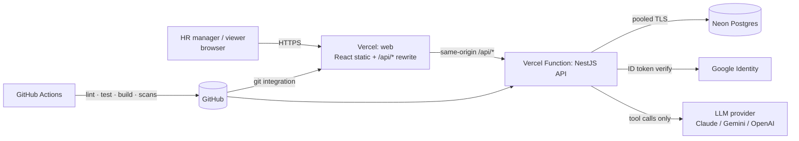

# PayLens — design

This is the map of the technical design. Each linked file is small and owns one topic.
Decisions and their trade-offs live in `../decisions/ADR-*.md`; this folder describes the
*result*. When code and this folder disagree, fix one of them in the same commit.

## Stack (decided, pending one recruiter answer)

| Layer | Choice | ADR |
|---|---|---|
| Monorepo | Nx 23, pnpm, Node 22 LTS+, TypeScript strict everywhere | ADR-001 |
| API | NestJS 12 (ESM, Vitest, Standard-Schema/Zod validation), REST + OpenAPI | ADR-002 |
| Data | PostgreSQL (Neon in prod, Docker locally, PGlite in tests) via Drizzle ORM 0.45 stable | ADR-002, ADR-004, ADR-005 |
| Web | **Default:** React 19 + Vite + shadcn/ui + Tailwind v4 + TanStack Query/Table + ECharts. **If the recruiter allows Angular:** Angular 22 + PrimeNG + ngx-echarts | ADR-003 |
| Shared | `libs/shared` (Zod schemas, DTO types, enums), `libs/domain` (pure TS: money, FX, bands, effective dating) | ADR-001 |
| Auth | Google Sign-In (ID token) → server-side session cookie; roles admin / hr_manager / viewer | ADR-006 |
| Assistant | Mastra agent embedded in the API, read-only tools, provider-neutral model | ADR-009 |
| Tests | Vitest + Testing Library + supertest + PGlite + Playwright | ADR-007 |
| Deploy | Vercel (web static + api function) + Neon; GitHub Actions CI; Dockerfile for the API | ADR-008 |

## Files

| File | Owns |
|---|---|
| [design/architecture.md](design/architecture.md) | Repo layout, runtime topology, module boundaries, request lifecycle, diagrams |
| [design/data-model.md](design/data-model.md) | Tables, enums, constraints (incl. no-overlap exclusion), indexes, money & FX rules |
| [design/api.md](design/api.md) | Endpoints, conventions (pagination, errors, concurrency, ids), OpenAPI |
| [design/frontend.md](design/frontend.md) | Web app implementation: routing, data layer, forms, state, folder layout, Angular variant |
| [design/ui.md](design/ui.md) | Design tokens, screens, components, interaction patterns, copy voice, accessibility |
| [design/analytics.md](design/analytics.md) | Metric definitions and formulas, canonical HR questions, SQL approach, caching |
| [design/ai-assistant.md](design/ai-assistant.md) | Agent design, tools, guardrails, evals, cost controls |
| [design/security.md](design/security.md) | Threat model, controls per OWASP Top 10:2025, verification checklist |
| [design/testing.md](design/testing.md) | Pyramid, harnesses (PGlite, fakes, fixed clock), TDD cadence, coverage |
| [design/deployment.md](design/deployment.md) | Environments, env vars, migrations, CI/CD, rewrites, Docker |
| [design/seed.md](design/seed.md) | The 10,000-employee generator: distributions, rules, performance |

## Architecture principles (the ones we will be asked about)

1. **Domain logic is framework-free.** `libs/domain` has no Nest, no React, no DB. It is
   where TDD is fastest and where correctness matters most (money, dates, bands).
2. **Contracts are shared, not duplicated.** One Zod schema validates the request in Nest
   and the form in React. Types are inferred from schemas, never hand-written twice.
3. **The database enforces invariants too.** Not-null, foreign keys, check constraints,
   and an exclusion constraint that makes overlapping salary periods impossible, even for
   a future bug in the service layer.
4. **Read models are SQL.** Analytics are SQL queries with window functions and
   `percentile_cont`, tested against real Postgres (PGlite). No in-memory aggregation of
   10,000 rows in Node.
5. **Stateless API.** Sessions live in Postgres; the API runs as a serverless function on
   Vercel today and as a container on Cloud Run tomorrow without code changes.
6. **Security is a layer, not a feature.** Guards + policies + field masking + DB grants;
   each layer tested independently.
7. **Everything observable.** Request ids end-to-end, structured logs with redaction,
   health endpoints, audit events for every mutation, AI calls logged.

## Diagram (system context)

Detailed diagrams (containers, request lifecycle, salary change sequence) are in
[design/architecture.md](design/architecture.md).

## Open design decisions (tracked in progress.md)

- ~~Frontend framework~~ — React, final (D-1, 2026-11-15).
- ~~Gender in the data model for F-22~~ — female | male, required (D-2, 2026-11-15).
- Assistant model provider for the deployed demo — Claude Haiku (paid, ~$5) vs Gemini Flash-Lite (free, 500 req/day).
