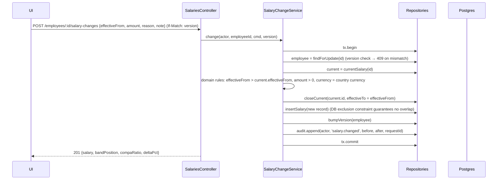

# Architecture

## Repository layout (Nx monorepo, pnpm)

```
paylens/
├─ apps/
│  ├─ api/                 NestJS 12 application (ESM)
│  │  └─ src/
│  │     ├─ main.ts        bootstrap (helmet, cookies, validation, swagger, filters)
│  │     ├─ app.module.ts
│  │     ├─ common/        exception filter, interceptors (request-id, audit, logging), guards, decorators
│  │     ├─ auth/          google token verify, sessions, demo login, roles
│  │     ├─ employees/     controller → service → repository
│  │     ├─ salaries/      salary change use-case, history
│  │     ├─ pay-bands/
│  │     ├─ fx/            fx rates + converter adapter over libs/domain
│  │     ├─ analytics/     SQL read models
│  │     ├─ imports/       csv import jobs
│  │     ├─ audit/         append-only audit events
│  │     ├─ assistant/     Mastra agent, tools, evals
│  │     ├─ health/
│  │     └─ db/            drizzle schema, migrations, client, seed
│  ├─ web/                 React 19 + Vite (or Angular 22 — see frontend.md)
│  └─ web-e2e/             Playwright journeys
├─ libs/
│  ├─ domain/              pure TS: Money, FxConverter, bands, effective dating, csv row rules
│  └─ shared/              Zod schemas, DTO types, enums, API route constants
├─ docs/                   requirements, vault, decisions, ai, demo script
├─ .github/workflows/      ci.yml (lint/typecheck/test/build/audit/secrets)
├─ docker-compose.yml      local Postgres
├─ Dockerfile              api container (Cloud-Run-ready)
└─ CLAUDE.md
```

Boundaries (enforced with Nx module-boundary lint rules):
`web → shared`; `api → shared, domain`; `domain → nothing`; `shared → zod only`.

## Runtime topology

```mermaid
flowchart TB
  subgraph Vercel
    W[web project<br/>static assets + rewrites /api/* → api]
    A[api project<br/>one Node function (Fluid compute)]
  end
  B[Browser] --> W
  W -. rewrite .-> A
  A --> N[(Neon Postgres<br/>pooled connection string)]
  A --> G[Google tokeninfo / JWKS]
  A --> L[LLM provider via Mastra model router]
```

- Same origin for the browser: the web project rewrites `/api/:path*` to the API deployment,
  so the session cookie is first-party and there is no CORS surface.
- The API is stateless; sessions and rate-limit counters live in Postgres (a Redis is not
  justified at this scale; documented upgrade path).
- Local dev: `pnpm dev` runs web (Vite proxy `/api` → `localhost:3000`) and api against
  Docker Postgres; tests use PGlite (no Docker needed for `pnpm test`).

## Request lifecycle (API)

1. `RequestIdMiddleware` — accept `x-request-id` or generate one; echoed in responses and logs.
2. `helmet` security headers; body size limits; cookie parsing.
3. `SessionGuard` — opaque cookie → session lookup → `req.user` (id, role, isDemo).
4. `RolesGuard` + `@Roles()` — deny by default; controllers declare what they allow.
5. `ZodValidationPipe` (Nest 12 Standard Schema) — DTOs from `libs/shared`; unknown keys stripped.
6. Controller → Service (business rule, transaction boundary) → Repository (Drizzle).
7. `AuditInterceptor` — for mutating routes, writes an audit event in the same transaction
   (service passes `tx` and `actor`); never fire-and-forget.
8. `ProblemDetailsFilter` — maps domain errors to RFC 9457 `application/problem+json`
   with `type`, `title`, `status`, `detail`, `instance`, `requestId`; no stack traces.
9. Structured log line per request (method, route template, status, duration, requestId,
   userId) with salaries/names/emails never logged.

## Salary change — sequence



## Module responsibilities (API)

| Module | Owns | Must not |
|---|---|---|
| auth | token verification, sessions, demo login, `@Roles`, policies | know about employees |
| employees | directory query (filters allowlist), profile, create/edit | compute money — delegates to domain |
| salaries | salary change use-case, history read model | bypass audit |
| pay-bands | CRUD bands, band lookup for (level, country, date) | own analytics |
| fx | rates table, `FxConverter` adapter (domain) | round differently from domain |
| analytics | SQL read models, caching | write anything |
| imports | parse/validate/commit CSV jobs | skip domain validation |
| audit | append events, query timeline | update/delete |
| assistant | agent, tools (call analytics service), evals, caps | access repositories directly |

## Frontend architecture (summary; detail in [frontend.md](frontend.md))

Feature folders mirror API modules. Server state only in TanStack Query (keys are route
constants from `libs/shared`). Forms use react-hook-form with the shared Zod schema.
Routing: React Router with lazy routes per feature. No global client state store; URL is
the state for lists (filters, sort, page). Components: `ui/` (shadcn primitives, themed),
`components/` (PayLens composites such as `BandBar`, `MoneyText`, `DataTable`), `features/*`.

## Scalability notes (for the interview)

- 10k rows: offset pagination + indexes is enough (p95 < 300 ms target). 100k+: switch to
  keyset pagination (cursor on `(last_name, id)`), add materialized analytics with refresh
  on write, move rate limits/sessions to Redis, and read replicas on Neon.
- The API is one deployable; module boundaries let `analytics` or `assistant` be extracted
  to their own service without touching the others.
- Horizontal scale is free on Vercel functions; the constraint is DB connections → pooled
  connection string (PgBouncer) and short transactions.
